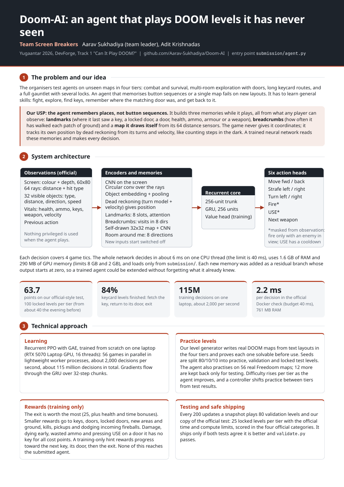
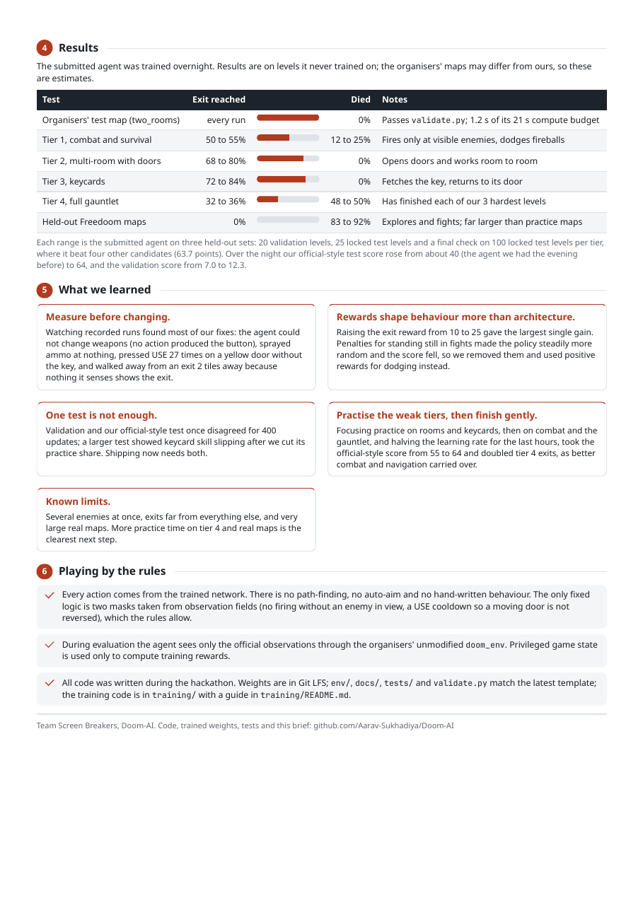

# Doom-AI

**An autonomous agent that learns to play unseen DOOM levels from scratch.**

> **Yugaantar 2026 · DevForge · Track 1: "Can It Play DOOM?"**  
> **Team Screen Breakers:** Aarav Sukhadiya (Team Lead) & Adit Krishnadas

---

## Overview

For decades, *"Can it run DOOM?"* was the benchmark for hardware. This project flips the question: **can a neural network actually play DOOM?**

Conventional game bots break the moment a wall shifts or an enemy spawns in a new spot because they replay memorised button sequences. **Doom-AI** learns generalisable gameplay from scratch: no pre-built maps, no demonstration datasets, and no scripted navigation. Through pure trial and error, the agent learns to survive combat, open doors between rooms, collect keycards, backtrack to the matching locked door, and reach the exit on levels it has never seen before.

---

## Key Differentiator: Spatial Memory

**The agent remembers places, not button sequences.**

A human player exploring a new DOOM level makes mental notes, such as *"there was a red locked door back near the start"*, and returns once they find the red key. Doom-AI mirrors this behaviour by constructing three forms of spatial memory on the fly:

- **Landmarks:** Records the locations of key entities as they appear (locked doors, keycards, standard doors, health, ammo, armour, and weapons). Once holding a key, the agent can navigate directly back to the corresponding locked door.
- **Breadcrumbs:** Tracks visitation density across traversed areas so the agent distinguishes explored corridors from new ground.
- **Self-Drawn Map:** Projects 64 distance-sensor readings onto an egocentric (agent-centred) local grid marking open floor, walls, and doors, which the network reads like a mini-map.

The environment never exposes absolute coordinates. The agent estimates its own position solely through movement history (dead reckoning, like counting steps in a dark room). Every decision is still produced by the trained neural network; these memories simply give the policy structured spatial context.

---

## How It Works

| Component | Role | Everyday Analogy |
| --- | --- | --- |
| **Perception** | 64 surrounding distance rays (reporting walls, doors, locked doors, enemies, and items), an in-view entity list (enemies, items, keys, incoming projectiles), scalar stats (health, ammo, keys), and a downscaled screen frame. | Walking with your eyes open and arms outstretched |
| **Memory** | Short-term temporal state combined with the landmark registry, breadcrumb trail, and self-drawn local map. | Remembering *"the red door is behind me, to the left"* |
| **Policy (Brain)** | A compact neural network mapping perception and memory directly to actions: move, strafe, turn, shoot, open doors, and switch weapons. | Deciding what to do next |
| **Training** | Reinforcement learning across millions of steps. Reaching the exit yields the largest reward; keys, doors, new rooms, kills, and pickups earn smaller bonuses; damage and death incur penalties. | Practising a game until strong habits stick |
| **Curriculum** | A custom procedural level generator producing endless layouts across four difficulty tiers, from single combat rooms to two-lock gauntlets, supplemented by 56 real Freedoom levels. | A coach assigning harder drills each week |

Because the agent trains across thousands of procedurally generated layouts, memorising individual maps is impossible. It is forced to learn transferable skills, which is precisely what the competition evaluates.

---

## Benchmarks

The checkpoint in this repository was trained overnight on a single laptop (~115 million decisions). Results below are measured strictly on **unseen levels** across three independent evaluation suites (up to 100 levels per tier):

| Evaluation Suite | Reaches Exit | Death Rate |
| --- | :---: | :---: |
| Organisers' test level (`maps/two_rooms.wad`) | 100% | 0% |
| Tier 1: Combat rooms | ~50% | 12 to 25% |
| Tier 2: Multi-room with doors | 68 to 80% | 0% |
| Tier 3: Single keycard levels | 72 to 84% | 0% |
| Tier 4: Two-lock gauntlets | ~33% | ~50% |
| Unseen real Freedoom levels | 0% *(not yet)* | Most runs |

**Notable progress:**
- Completed each of our three hardest test levels at least once, collecting both keycards and unlocking both doors en route to the exit.
- Overnight score on our local mirror of the official test improved from **~40 to 64**.

**Current limitations:**
- Engaging multiple enemies simultaneously.
- Locating isolated exits far from the main progression loop.
- Scaling to full-sized real Freedoom maps (significantly larger than our procedural tiers; the agent explores and fights effectively there, but does not yet reach the exit).

---

## Evaluation Pipeline

- **Continuous Validation:** Every 10 to 15 minutes during training, candidate checkpoints are tested on 80 held-out unseen levels. Repository weights are promoted only when a checkpoint clearly outperforms the incumbent **and** passes `validate.py`.
- **Official-Test Mirror:** A local benchmark replicating the competition rules as closely as possible: four tiers of locked levels excluded from training, matching per-map time limits, matching per-decision compute budgets, and scoring across all four official categories (*exit, progression, exploration, combat*).
- **Playback & Recording:** Best runs on the hardest levels are captured as video, and a live runner replays the current agent continuously at real-time speed.

---

## Competition Compliance

- **Purely Learned Policy:** Every action is generated by the trained neural network, with no hand-crafted *"if X, do Y"* heuristics, no pathfinding algorithms, and no auto-aim.
- **Permitted Action Masks:** Only two observation-derived masks are applied (both allowed under track rules): firing is masked when no enemy is visible, and `USE` enters a brief cooldown after activation so the agent does not accidentally reverse a moving door.
- **Strict Train/Test Separation:** Custom levels, reward shaping, and curriculum scaling are confined to training. During evaluation, the agent receives only standard player-visible observations through the organisers' unmodified wrapper.
- **Original Implementation:** All agent architecture, memory modules, level generators, and training pipelines were built during the hackathon and are included in this repository.

---

## Submission Deliverables

| Requirement | Location |
| --- | --- |
| Public repository, trained weights, and track entry point | This repo. Entry point: `submission/agent.py` · weights: `submission/weights/` |
| 2-page project brief (USP, architecture, technical approach) | [brief/brief.pdf](brief/brief.pdf) |

---

## Repository Structure

```text
.
├── submission/
│   ├── agent.py          # Track entry point executed by the organisers
│   └── weights/          # Trained network weights (Git LFS) and config
├── training/             # Level generator, training loop, and eval tools (see training/README.md)
├── maps/                 # Organisers' sample test level
├── env/                  # Official game wrapper (unchanged)
├── docs/                 # Official rules, scoring, and technical contract (unchanged)
├── tests/                # Official test suite (unchanged)
└── validate.py           # Official pre-submission checker (unchanged)
```

### Project brief

The brief is [brief/brief.pdf](brief/brief.pdf). The two pages are shown here as well:




For the full technical reference see [ARCHITECTURE.md](ARCHITECTURE.md). AI coding agents should start with
[AGENTS.md](AGENTS.md).

---

## Quick Start

```bash
# Install dependencies (Python 3.13: ViZDoom, official wrapper, PyTorch)
uv sync --group train

# Run official and custom test suites
uv run pytest

# Run the organisers' pre-submission validation checks
uv run python validate.py

# Watch the current agent play continuously in real time
PYTHONPATH=training uv run python -m doomai.live
```

For training instructions and hyperparameter details, see [training/README.md](training/README.md). For official rules, scoring, and the submission contract, see [docs/](docs/).

*Initialised from the organisers' starter template.*
